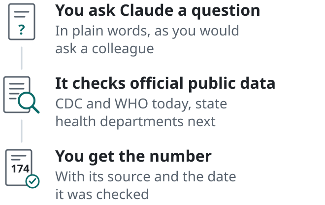
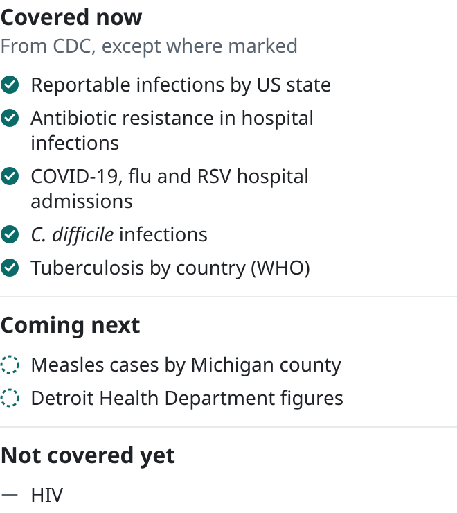
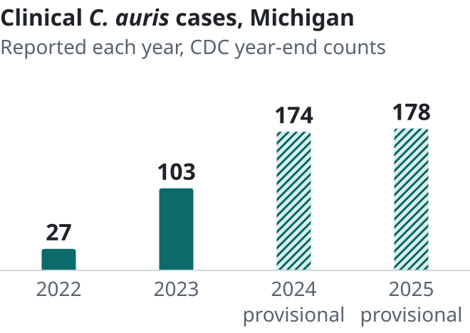

# health-data-registry

Ask Claude about infectious diseases in your state or country, and get the number from official public data, with
its source.

<picture>
  <source media="(prefers-color-scheme: dark)" srcset="assets/readme/how-it-works-dark.svg">
  
</picture>

It's free, for infectious-disease fellows and physicians who already use Claude, and needs no technical skills.
[Setting it up](#start-in-claude) takes five steps. It's still early: when it can't answer yet, it says so.

<!-- screenshot: a Claude chat with a question, the answer, and the source lines under it -->

## What you can ask

For example:

- "How many clinical C. auris cases did Michigan and Ohio report each year from 2022 to 2025?"
- "What share of Klebsiella from hospital infections in Ohio was carbapenem-resistant?"
- "What was WHO's estimate of tuberculosis incidence in South Africa each year since 2015?"

<picture>
  <source media="(prefers-color-scheme: dark)" srcset="assets/readme/coverage-dark.svg">
  
</picture>

## Start in Claude

You set this up once. There's nothing to download, and no account or password.

1. In Claude, open **Customize**, then **Connectors**. On some accounts it's under **Settings**, then
   **Connectors**. You'll see a list and an **Add custom connector** button.
   <!-- screenshot: Claude Settings → Connectors, with the Add custom connector button -->
2. Click **Add custom connector**, type the name `health-data-registry`, paste this link and click **Add**:

   ```text
   https://jtouley-health-data-registry-mcp.hf.space/mcp
   ```

   You'll see health-data-registry in the list. If you see an error, check that you pasted the whole link, with
   nothing before or after it.
3. Start a new chat: health-data-registry only appears in chats you start after adding it. Click **+** at the
   bottom left of the message box, then **Connectors**, and check that health-data-registry is switched on.
   <!-- screenshot: the + menu in a new chat, with health-data-registry switched on under Connectors -->
4. Check it works: in the message box, open the menu of ready-made starters, choose health-data-registry, then
   **Start here: check my tools work**. You'll see one line per tool saying whether it works, and steps for any
   that are missing. If the menu doesn't show it, copy [Start
   here](docs/helpers.md#start-here-check-my-tools-work) and paste it as your message.
5. Start your question with "Use health-data-registry:", then ask one of the questions above. If Claude asks
   before using it, allow it: it only reads public data. You'll see a table of yearly figures, then lines saying
   where the numbers came from and when. If Claude answers without those source lines, it didn't use
   health-data-registry: go back to step 3.

Stuck? The [setup guide](docs/setup.md) walks through every click, including what to do if your work account
blocks step 2.

## Example

You ask: *"How many clinical C. auris cases did Michigan report each year from 2022 to 2025?"*

Claude replies with the yearly counts, drawn here as a chart, and notes like these:

<picture>
  <source media="(prefers-color-scheme: dark)" srcset="assets/readme/example-c-auris-michigan-dark.svg">
  
</picture>

- **Source:** CDC's National Notifiable Diseases Surveillance System, with a link and a citation you can paste
  into a paper.
- **Checked:** 25 November 2026. Each solid bar is the total CDC reported at the end of that year.
- **Still changing:** CDC adds late reports for a year after it ends, so every figure here is provisional. Its
  later count is 33 for 2022, 110 for 2023 and 184 for 2024. For 2025 it is already 217 by week 45 of 2026,
  and still rising. The answer shows both figures for each year and calls neither final.
- **What it can't tell you:** where patients were treated, because each case counts in the patient's home state.
  Clinical and screening cases are separate counts, never added together.

Every answer links to the publisher's page; for this one, [CDC's weekly notifiable disease
data](https://data.cdc.gov/d/x9gk-5huc). If it works something out itself, like a rate per 100,000, it says so
and shows how.

## Use it with GBD and PubMed

Each tool has its own job: IHME's GBD connector for modelled burden, this tool for reported and local numbers, and
PubMed for papers. This tool labels its numbers with GBD's place and cause names and tells Claude which GBD
question to ask next, so you can set the two side by side. It never says which number is "right".

- **Add the other two:** the [setup guide](docs/setup.md#ihme-gbd-connector) covers the IHME GBD and PubMed
  connectors.
- **Keep them in their lanes:** run the [Set up my Claude Project](docs/helpers.md#set-up-my-claude-project)
  helper, and it writes the rules into your Claude Project.

## What it won't do

- **Touch patient data.** It reads only public, population-level numbers. Keep patient information out of the chat.
- **Guess.** If a number doesn't exist, it says so and suggests where to look.
- **Replace the source.** Check a figure on the publisher's page before you publish it.
- **Model disease burden.** For modelled estimates, use [IHME's Global Burden of Disease tool for
  Claude](https://claude.com/connectors/ihme-gbd).

If Claude gives a number with no source beside it, ask: "Where did that number come from?"

One thing isn't done yet: no second person has checked the rules this tool uses to read each source. Every
answer says so. Until that check is done, compare important figures with the publisher's page.

## Who made it, and getting help

Jason Touleyrou ([jtouley](https://github.com/jtouley)) made it and looks after it on his own. It's open source.

- **Something isn't working:** paste the ready-made [Something's wrong](docs/helpers.md#somethings-wrong) message
  into a new chat and fill in what you see.
- **A number looks wrong, or you'd like a source added:** report it on
  [GitHub](https://github.com/jtouley/health-data-registry/issues/new/choose) (free account needed). If the
  publisher's page disagrees with an answer, trust the publisher.

---

## For developers and data people

The technical detail lives in these pages:

- **Every way to set it up,** including Claude Code, Team and Enterprise plans, and a local install:
  [docs/setup.md](docs/setup.md)
- **What each tool does,** its inputs and what it returns: [docs/tools.md](docs/tools.md)
- **The ready-made helpers,** as copy-paste prompts: [docs/helpers.md](docs/helpers.md)
- **How to read the data:** counts versus rates, provisional years, empty cells, places, age standardisation:
  [docs/data-conventions.md](docs/data-conventions.md)
- **One entry per dataset:** publisher, years, places, licence, citation: [catalog/](catalog/)
- **How it works:** fetching, data contracts, the open data hub, the server: [docs/architecture.md](docs/architecture.md)
- **Why it works that way:** [docs/adr/](docs/adr/README.md)
- **Commands, tests and adding a dataset:** [docs/dev/README.md](docs/dev/README.md) and
  [CONTRIBUTING.md](CONTRIBUTING.md)
- **How answers are tested:** [eval/README.md](eval/README.md)
- **What may be stored or republished** for each kind of licence: [licenses/README.md](licenses/README.md)

[](https://scorecard.dev/viewer/?uri=github.com/jtouley/health-data-registry)
[](https://github.com/jtouley/health-data-registry/actions/workflows/ci.yml)
[](LICENSE)

### Run it locally

You need [uv](https://docs.astral.sh/uv/) (it installs Python 3.12 or 3.13 if needed) and Git.

```bash
git clone https://github.com/jtouley/health-data-registry.git
cd health-data-registry
make install   # uv sync
make check     # lint, type check, tests, mutation tests on changed modules
make serve     # the MCP server over stdio
```

### Tools

The server is a read-only MCP server. Claude picks the tools; nobody calls them by hand.

<details>
<summary>The tool list, as the server describes each tool to Claude</summary>

<!-- tools:start (generated by `make docs` from the server's tool registry; don't edit) -->

| Tool | What it gives you |
|---|---|
| `list_sources` | What's loaded: each source's publisher, years, places, how often it updates, when it was last fetched, its licence and whether its contract has been reviewed. geography_level: nation, state, county, country. |
| `search_datasets` | Datasets that fit a topic (e.g. "legionella", "syphilis in states"), ranked, each with a one-line reason. |
| `describe_dataset` | A source explained in clinical words: what one row is, the conditions and case definitions, what each column means, counts vs rates, missing codes, total rows, caveats, licence and how to cite it. |
| `suggest_datasets` | For a research question in plain words: which sources can answer it, which can't and why. |
| `get_series` | Observed values over time for a condition (e.g. "legionellosis") in places (e.g. ["Michigan", "Ohio", "United States"]), one row per place and year, each with its source, fetch time and case definition. measure: cases, deaths, rate, percent. |
| `get_aligned_with_gbd` | The same observed rows keyed to GBD location and cause names, plus the exact IHME GBD connector call to run next. |
| `get_rate` | How common is it here? Crude rate per 100,000 (cases / Census population) with an exact Poisson 95% interval, computed here and never age-standardised. |
| `compare_rates` | Is it higher here than there, or now than then? Rate ratio and rate difference with 95% intervals, between two places in one year (other_location) or one place in two years (other_year). |
| `get_trend` | Is it rising? Annual percent change with a 95% interval from a Poisson regression on year. |
| `age_adjust` | Does age explain the difference? Rate directly standardised to the 2000 US standard population, with the gamma (Fay-Feuer) interval NCHS uses. |
| `check_signal` | Is this week unusual? The last 4 weeks' cases against the same, preceding and following 4 weeks of the past 5 years, in the style of CDC's historical limits for notifiable diseases. |
| `get_provenance` | Where a source's numbers came from: the exact URLs, when they were fetched, content hashes, case definitions and how to cite them. |
| `list_caveats` | What the data can't tell you: geography traps, suppression, provisional years, unreviewed contracts and facts not yet confirmed with the publisher. |
| `find_prior_work` | Conference abstracts, case reports and health department reports on a condition, with the datasets each used. (The index is not built yet; the tool says so rather than guessing.) |
| `get_publication_outlook` | How often presented abstracts at a conference (e.g. "IDWeek", "CROI") became full papers: one row per stage from idea to paper, each with its source, n and 95% interval, or "unknown". |
| `query_sql` | Escape hatch for questions the other tools don't cover: one read-only SELECT over loaded sources (tables are named by source_id). |

<!-- tools:end -->

</details>

### Cite, licence and security

- **Cite the data** with the publisher citation each answer gives. **Cite this software** with
  [CITATION.cff](CITATION.cff) and the version you used. Check your journal's rules on AI tools.
- **Code:** [Apache-2.0](LICENSE). **Data** keeps each publisher's terms, shown with every result. No data is
  stored in this repository.
- **Security:** report vulnerabilities privately, as [SECURITY.md](SECURITY.md) describes.
