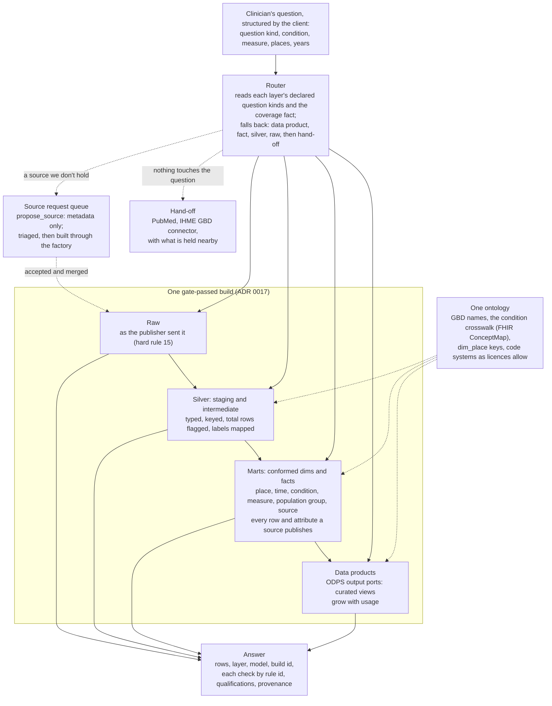

# 0020. Answer with what we hold: contracted layers, one ontology, one quality engine and a router

- **Status:** Proposed
- **Date:** 2026-11-28
- **Spec:** none; the maintainer's decisions of 27 Nov 2026 in issue
  [#283](https://github.com/jtouley/health-data-registry/issues/283) (release blocker), the "United States"
  decision of the same day, and the maintainer's restatement of the core architecture
- **Supersedes in part, once accepted:** [ADR 0001](0001-crawl-outside-claude.md)'s "the server reads only
  snapshots" (it reads gate-passed builds); in [ADR 0017](0017-immutable-raw-reproducible-builds.md) (proposed),
  the section 6 rows where a data failure blocks `LATEST` or publishing (already superseded in principle by
  [ADR 0018](0018-show-everything-qualify-dont-decide.md))
- **Related:** [ADR 0003](0003-provenance-on-every-result.md) (provenance on every result),
  [ADR 0004](0004-aligned-data-no-gbd-verdicts.md) (GBD-aligned data, no verdicts),
  [ADR 0007](0007-odcs-contracts-and-semantic-models.md) (contracts and the contract facts rule),
  [ADR 0008](0008-governed-sql-and-metrics.md) (governed SQL and metrics),
  [ADR 0009](0009-licences-decide-mirroring.md) (licences decide mirroring),
  [ADR 0015](0015-elt-raw-data-stored-as-sent.md) (ELT, proposed), [ADR 0016](0016-crawler-factory.md)
  (the factory pattern), [ADR 0017](0017-immutable-raw-reproducible-builds.md) (builds, proposed),
  [ADR 0018](0018-show-everything-qualify-dont-decide.md) (qualify, don't decide)

"Hard rule N" means rule N in [CLAUDE.md, Hard rules](../../CLAUDE.md#hard-rules). "Silver" means the staging
and intermediate models together. File pointers are to `main` at the time of writing unless a pull request is
named.

## Decision 0. Product principle: answer with what we hold

The maintainer's words: "We are product driven. Physicians need to use this. We don't know how all the data may
be useful to them, and they can't get 'I don't have an answer to that' when we have all kinds of data pulled in,
categorized, with contracts, context layers and semantics."

- **Fall back, don't refuse.** When no data product or fact fits a question, the router drops to silver, then
  raw. It uses the contracts, the ontology and the semantic models to find whatever related data exists. It
  answers with the closest data held, qualified: its layer and checks, what is missing, and how it differs from
  what was asked. It then suggests the next question.
- **"No answer" only when nothing exists:** no catalogued data touches the condition, the place or the time.
  Even then the answer says what is held nearby and hands off to the PubMed or IHME GBD connector (ADR 0004).
- **Qualify, don't decide** (ADR 0018). A fallback answer never claims to be what was asked. It says what it is.
- **The measure of success** is the share of evaluation questions that get "no answer". It should fall release
  over release, while answer correctness holds the release bar (decision 4 says where it is tracked).

Everything below serves this principle. The router (decision 4) is where it is enforced.

## The architecture

The server holds all the data it serves, categorized, with a contract at every layer. Each layer carries its own
context, its own semantic model and its own quality checks, and every layer refers to one ontology. A router knows
which kinds of question each layer's models answer. It sends each question to the highest layer that can answer it
and falls back layer by layer (decision 0). Every layer an answer reads comes from one build that the release gate
passed.

| Layer | What it holds | Contract | Semantic model declares | Quality checks |
|---|---|---|---|---|
| Raw | The publisher's bytes and records exactly as sent (hard rule 15) | The loose raw contract (`_raw_sources.yml`) | Provenance and fields as sent | Integrity: each sha256 matches its object (#269, #277); the record count matches the manifest; the expected fields are present; has-rows |
| Silver | Typed, keyed, total rows flagged, labels mapped | Each `stg_*` and `int_*` model's ODCS contract | Exploration of the source's own columns | The contract's ODCS quality rules, key uniqueness, fill rates, reconciliation with raw (#240) |
| Marts | Conformed dims and one fact per published dataset, spanning every row and attribute | Each `dim_*` and `fct_*` model's ODCS contract | Counts, rates, trends, comparisons, signals, coverage, exploration | Everything silver has, plus product tests: business-logic unit tests and accepted values |
| Data products | Curated views over the facts, one per ODPS output port | The port's ODPS entry and the view's ODCS contract | The question kinds the port is curated for | The mart's checks, plus the port's own product tests |

Decisions 1 to 5 are the parts of this architecture: the layered read path, one quality engine, one ontology with
conformed dimensions, the router, and demand-driven ingestion of sources we don't hold yet.

## Context

The maintainer flagged four things that are drifting apart:

1. **Read path.** `query.Engine.connect` serves each source from a lake snapshot (`data.duckdb`), a hub release
   Parquet file (`hub.Hub.snapshot`, the snapshot's `data.parquet`) or a live in-memory table
   (`live.load_live`). None of those is a dbt model. The dbt tests run in `make transform` and in the release
   gate, but no answer reads what they tested. The first marts (`fct_cdc_haicviz_isa`, `fct_cdc_haicviz_mugsi`)
   have no reader, and the semantic models name source columns that the marts rename (#236, #265).
2. **Quality.** Contract rules run through two engines. `quality.run_rules` measures them in Python on every
   snapshot and live read (`staging.check_snapshot`, `staging.stage_checked`). `transform_gen.quality_tests`
   turns the same `measure_sql` into `odcs_check` dbt tests. #240 adds dbt-expectations checks from
   `dq_checks.CHECK_TYPES`, which `quality.run_rules` skips, so live reads never run them.
3. **Places and coverage.** Place keys live only in `geo.py`, where Puerto Rico is a state. The catalog's
   `geography` list is kept by hand, and `list_sources`, `search_datasets`, `suggest_datasets` and
   `analysis.py` read it as coverage. Coverage itself is prose (`geographyBasis`) or, in #185,
   `conformedDimensions` read untyped from `contract.raw` (#223, #247).
4. **Routing.** `suggest_datasets` and `get_series` decide fit by string matching: `tools._tokens`, `_STOP`,
   `STOP_WORDS`, `_GEO_WORDS`, `_haystack` and `catalogued_labels` on main; `coverage.ABBREVIATIONS`,
   `coverage.GENERIC_WORDS` and the capitalised-word reader `tools._unplaced` in #185; `Series.asked_with` in
   #244 and the coverage source PRs (#180, #245, #246). Each new source adds words to these lists.

## Decision 1. A layered read path from one gate-passed build

### The decision

- **Every answer reads one build.** The server reads the models of one build the release gate passed (ADR 0017's
  `builds/<build_id>/`), and every layer an answer touches comes from it. The gate holds a build when a model
  failed to build or any layer's check has no result (#222). A check that ran and failed does not hold it: the
  answer carries the failure as a qualification (ADR 0018, #243).
- **Facts span the full range of the data.** Each published dataset has one fact in the marts, keyed to the
  conformed dimensions (decision 3), holding every row and every attribute the source publishes, not only the
  ones popular questions use.
- **Data products are curated views on the facts.** Each ODPS output port is one view with its own contract and
  product tests. Ports grow with usage, under the promotion rule below.
- **Every layer is served.** The router (decision 4) sends a question to the highest layer that declares its
  kind: a data product, then a fact, then silver (exploration, `describe_dataset`, a column the fact doesn't
  carry yet), then raw (a field as sent, provenance).
- **Every answer names its layer.** The envelope (`query.envelope`, `query._source`) gains `layer`, `model`,
  `build_id`, and `checks`: each check on that model in that build, by rule id, with its status (pass, warn,
  fail, not evaluated). A raw-layer answer also says "as the publisher sent it; integrity checks only".
- **Semantic models point at models, not sources.** Each metric and series names the dbt model it reads
  (`model: fct_cdc_haicviz_isa`). Its dimension and measure names are that model's column names, so there is one
  vocabulary (#236). `registry.py` refuses a semantic model whose columns are not in the named model's contract.
- **`query_sql` reads models by name.** Tables are model names: data products, marts and silver by default, raw
  by naming it. Each model's columns come from its ODCS contract (every layer has one, #131). For one release a
  bare `<source_id>` resolves to that source's staging model, with a caveat that says so.
- **Stored sources** come from the build's DuckDB file on a maintainer's lake, or from the hub release, which
  publishes the build's per-model Parquet files instead of the snapshot's `data.parquet` (ADR 0017 section 3).
- **Live sources** (restricted terms) join the dbt project. Their models are generated and tested on synthetic
  fixtures in CI, and their raw source is empty in every stored build. At question time the server runs that
  build's compiled SQL (dbt's `target/compiled`, shipped in the build and the release) over the live records, in
  memory, for whichever layer the question needs, with the same compiled checks (decision 2). Nothing is written
  to disk (ADR 0009). Private-tier sources take the same path.
- **Provenance (hard rule 8) carries through by row.** Every model keeps `_snapshot_id` and `_raw_sha256` on each
  row, under one name across marts (#261). The answer's source block lists, for each snapshot id in the rows
  returned, the source URLs and `retrieved_at` from that snapshot's manifest as `build.json` pins it, plus the
  build id, the model and its contract version. A fact that unions sources lists each one. A live answer names
  the live snapshot id from `live.fetch_live` and the build whose compiled SQL ran.

### The promotion rule: when a question pattern becomes a data product

A question pattern gets its own data product when **either**:

- a consumer needs a stable port for it: a new ODPS output port is proposed; or
- the pattern recurs: it appears in the evaluation's development set, a helper journey (such as `make smoke`), or
  two or more clinician issues. There is no telemetry (hard rule 6), so usage is counted only from these.

The promotion pull request adds the curated view with its ODCS contract and product tests, repoints the semantic
series at it with `model:`, adds the ODPS port, and adds a test that the series returns the same rows from the
view as from the fact (or from silver, if the fact doesn't carry the column yet) on the fixtures. If a number
changes, the pull request says which and why. A port is never removed without a pull request that says so.

### What changes from today

| File | Change |
|---|---|
| `query.py` | `Engine.connect` attaches the build's models instead of snapshots; `compile_metric` reads `series.model`; `envelope` and `_source` carry layer, model, build id and checks; `query_sql` allows model names |
| `hub.py`, `publish.py` | Releases carry per-model Parquet, the compiled SQL and the build's check record; `Hub.snapshot` becomes a per-model read |
| `live.py` | `load_live` runs compiled model SQL instead of `staging.stage_checked` |
| `registry.py` | `Series.model` and `Metric.model`; semantic columns checked against the model's contract |
| `sql_guard.py` | Allowed tables are models; raw needs naming |
| `transform_gen.py`, `dbt_raw.py` | Live sources get generated models; `dbt_raw` reads only what `build.json` names (ADR 0017) |
| `store.py`, `staging.py` | `build_snapshot` keeps writing raw and the manifest; its typed `data.duckdb` stops being served (ADR 0017 section 8) |
| `transform/models/marts/` | One fact per published dataset, every row and attribute, on the conformed dimensions |
| `contracts/health-data-registry.odps.yaml`, `product.py` | Each output port names its curated view and that view's contract version (#76) |
| `semantic/*.yaml` | Each series names its model; names follow the model's columns |

### Migration order

Each step is one pull request on the usual cycle, and main stays green after each. No snapshot is rewritten: old
snapshots stay raw inputs that builds read by hash (hard rule 15).

1. Mart conventions (#261): one provenance column naming, generated status columns. No reader changes.
2. Build directories and the per-model release (ADR 0017 section 3, #206).
3. `Series.model` and `Metric.model`, defaulting to the staging model. A golden test (`tests/golden`) shows the
   staging model returns what today's snapshot table returns on the fixtures.
4. `Engine` reads the build; the envelope names layer, model, build id and checks. `<source_id>` stays an alias.
   Lake pins (`lake_pins`) for older pages keep reading their snapshot until it ages out.
5. One pull request per source: its fact on the conformed dimensions, every row and attribute, and its series
   repointed at the fact. HAICViz iSA and MuGSI first, since their facts exist.
6. Data products: today's one-port-per-source ODPS file becomes curated views, each by the promotion rule.
7. Live and private sources move onto compiled SQL. `staging.stage_checked` and the Python serving copy are
   retired once every source is on step 4.
8. Drop the `<source_id>` alias.

### What it closes or supersedes

- Closes #283 when step 7 lands, and #236 and #265 when their series read the facts.
- Supersedes #131's "raw and staging only as a labelled fallback": every layer is served and qualified. #131's
  per-layer contracts and "every source has a fact" stand.
- #261 is step 1.

### Open questions for the maintainer

1. Does the hub release publish raw-layer files for redistributable sources, or does raw stay on the maintainers'
   lake and in the private raw archive, with silver the lowest layer clinicians can read?
2. Is the promotion threshold right: a proposed port, the development set, a helper journey, or two clinician
   issues?
3. A user who runs `refresh` on their own machine (the "What runs where" table in
   [docs/architecture.md](../architecture.md)) would then need dbt to serve. Is dbt-duckdb a server dependency,
   or does local `refresh` become a maintainers-only command?

## Decision 2. One quality engine

### The decision

- **Rules are declared once**, in the ODCS contract of the layer they check, and in the ODPS entry for a port's
  product tests. Nothing else declares a check.
- **One contract-bound factory compiles them.** `transform_gen.py`, with #240's `dq_checks.CHECK_TYPES` as its
  one registry, turns every declared rule into a named dbt test: `odcs_check` for SQL rules, dbt-expectations for
  ranges, reconciliation and freshness (#240), and dbt's own tests for keys and accepted values. A new kind of
  check is one registry entry, ADR 0016 style, never a new code path.
- **Every layer gets its own checks,** as the table under [The architecture](#the-architecture) sets out: raw
  integrity, silver's contract rules and reconciliation, and the marts' and data products' product tests.
- **Stored and live data run the same compiled SQL.** A stored build's results come from dbt's
  `run_results.json` and go into the build's check record. A live or private read runs the same compiled test SQL
  from the build over its in-memory tables and writes the same record.
- **Qualify, don't decide (ADR 0018).** A check that ran and failed travels with the answer as a qualification
  citing its rule id. A check that never ran holds the build, or refuses a live table for that question (#222).
  Business-logic unit tests run on fixtures in CI, so a failing one never reaches a build.
- **`quality.py` shrinks to judging.** It keeps the verdict logic (`QualityReport`, `expected_ids`,
  `unchecked_message`) over the check record. Its measuring engine (`run_rules`, `measure`, `measure_sql`,
  `condition_sql`) moves into the factory or goes.

### What changes from today

| File | Change |
|---|---|
| `quality.py` | Rule parsing moves to `registry.py`; measurement moves to the factory; judging stays |
| `transform_gen.py`, `dq_checks.py` (#240) | The one factory: raw integrity checks and product tests join the generated tests |
| `staging.py` | `check_snapshot` and the checks in `stage_checked` go once nothing serves the snapshot copy |
| `store.py` | `_promote` judges the snapshot by raw integrity only; silver and mart checks belong to the build |
| `release_gate.py` | `expected_from` expects every layer's checks; only checks that never ran and models that failed hold a build |
| `live.py`, `query.py` | Live and private reads run compiled tests and judge them with `quality.py` |

### Migration order

1. #240 lands: dbt-expectations under one registry.
2. Raw integrity checks are declared and generated (#269 first, then #277).
3. The release gate holds only on checks that never ran or models that failed to build (#243). Data failures
   become qualifications in the check record.
4. Live and private reads run compiled tests (with decision 1, step 7). Until then they keep `run_rules`, and
   their answers say that the dbt-expectations checks did not run on that read.
5. Remove `quality.run_rules`, `staging.check_snapshot`, and the snapshot judging in `store.py` beyond raw
   integrity.

### What it closes or supersedes

- Closes #225 (quality records on every mart, cited in answers) and #243.
- Completes #240's follow-up that the read path skips `custom` rules.
- Supersedes the "Contract quality rules, severity error: data failure" row of ADR 0017 section 6.

### Open questions for the maintainer

1. A publisher's own repeated key fails silver's uniqueness test. Under ADR 0018 that qualifies the answer. Does
   it still hold the build, since a fact's joins to the dimensions would double the rows?
2. Freshness on a live read: does the live table carry the same SLA checks as a stored build, or a lighter set?

## Decision 3. One ontology and conformed dimensions

### The decision

- **One ontology maps conditions, measures and places across sources.** It holds GBD cause and location names,
  the condition crosswalk (a FHIR ConceptMap, kept as a control-plane export that a maintainer reviews, ADR 0017
  section 1), and code systems as their licences allow (SNOMED CT stays optional and unbundled, ADR 0007). The
  semantic model of every layer refers to its terms; no layer keeps its own list of names.
- **The conformed dimensions are marts built from it:** `dim_place`, `dim_time` (the MMWR calendar,
  `mmwr_calendar`, and years and seasons), `dim_condition`, `dim_measure`, `dim_population_group` and
  `dim_source`. Each has an ODCS contract in `contracts/models/`. Their inputs are catalogued sources and
  contracted control-plane exports; there are no seeds.
- **`dim_place` is the only source of place keys.** It holds each place's key, level (nation, state, territory,
  county, city, country, WHO region), parent, names and aliases (name, postal code, FIPS, ISO3, GBD location
  name). Its contract declares the key grammar once (`USA`, `US-<state FIPS>`, `US-<5-digit FIPS>`,
  `<parent>/<name>`, #247). `geo.py` reads it, and a test checks that every key `geo` can return exists there.
- **`dim_condition` holds every condition label and alias** a source uses, tied to its GBD cause and crosswalk
  concept, including clinical abbreviations (TB, HCV, MRSA). Aliases route questions only; they never change a
  number.
- **Coverage is declared in each contract** as a typed `coverage` block (#223): kind, places with `valid_from` and
  `valid_to`, the denominator, and the publisher page that states it. It replaces `geographyBasis` prose and
  #185's untyped `conformedDimensions`. `registry.py` validates it and fails the load on a bad key. dbt builds it
  into `dim_dataset_coverage` (slowly changing, on the publisher's timeline) and
  `fct_dataset_place_year_coverage`, as #223 designs them.
- **The catalog's `geography` is derived**, not kept: `list_sources`, `search_datasets` and the catalog card read
  the levels of each source's declared places.
- **"United States" means the publisher's own national scope** (maintainer decision of 27 Nov 2026). Each source's
  coverage block names which of its rows is the national figure and what it includes, from the codebook.
  Nothing adds states up to make a national figure.
- **Territories are separate places.** Puerto Rico, Guam, the US Virgin Islands, American Samoa and the Northern
  Mariana Islands have level `territory`, never `state`.
- **The live-read coverage gate applies once,** where live reads start (`Engine._obtain`), not per tool (#248).

### What changes from today

| File | Change |
|---|---|
| `geo.py` | Reads `dim_place`; Puerto Rico becomes a territory |
| `registry.py` | `CatalogEntry.geography` is removed; `Contract.geography_basis` gives way to a typed `coverage` block |
| `catalog/*.yaml` | `geography` is dropped; condition labels and aliases feed `dim_condition` |
| `contracts/*.odcs.yaml`, `contracts/models/` | Each source gains `coverage`; each conformed dimension and coverage model gets a contract |
| `transform/models/marts/` | The six conformed dimensions, `dim_dataset_coverage`, `fct_dataset_place_year_coverage` |
| `tools.py`, `analysis.py` | Read the coverage fact instead of `e.geography` |
| `coverage.py` (#185) | Reads the coverage fact through the seam its docstring plans |
| `query.py` | `Engine._obtain` takes the requested place keys and applies the coverage gate |

### Migration order

1. A typed `coverage` block in `registry.py`, optional at first, with key validation (#247).
2. `dim_place` and its contract, and the test that every `geo` key exists in it. `geo.py` reads it.
3. Territories become their own level. This changes what some answers call Puerto Rico, so the pull request
   lists every answer that changes.
4. `dim_condition`, `dim_measure`, `dim_population_group` and `dim_source`, with the crosswalk export.
5. Coverage blocks per source, each citing its publisher page. A place not stated there is `unknown` and an open
   question (hard rule 1).
6. The coverage models (#223), and the readers move onto them. The live gate moves into `Engine._obtain` (#248).
7. `validate` warns on a catalog `geography` field for one release, then refuses it.

### What it closes or supersedes

- Closes #223, #247 and #248.
- Supersedes the coverage inference in #185 (`declared_coverage` reading `conformedDimensions` from
  `contract.raw`).

### Open questions for the maintainer

1. Where do the place names and aliases Census doesn't list come from: one control-plane export a maintainer
   reviews, or a catalogued reference source per place family (WHO countries, cities reported apart, #266)?
2. NNDSS publishes both `TOTAL` and `US RESIDENTS`. Which is its national figure? The codebook should say; until
   it does, that stays an open question in the contract.
3. Which code systems beyond GBD names and the crosswalk join the ontology first (ICD-10-CM, LOINC), given their
   licences?

## Decision 4. A router that knows each layer's question kinds

### The decision

- **Each layer's semantic model declares the question kinds it answers.** The kinds are: counts, rates, trends,
  comparisons, signals, coverage, provenance, exploration and literature hand-off. Each series and metric also
  declares, in an `answers` block, the conditions and measures it serves, as `dim_condition` and `dim_measure`
  keys. Places and years come from the coverage fact (decision 3), not from a second list. A kind that only a
  question about it should get, such as vaccination coverage, is a declared kind; it replaces `asked_with` (#244).
- **The client structures the question.** `suggest_datasets` and `get_series` take a question kind, a condition,
  a measure, places and years, which Claude fills from the clinician's words. A free-text `question` is still
  accepted, matched only against declared vocabulary (`dim_condition` and `dim_place` names and aliases, the
  declared kinds), and the answer says how it was read.
- **One router classifies and sends.** It resolves the terms through the ontology, finds the models whose
  semantic model declares that kind for that condition and measure, checks the coverage fact for the places and
  years, and picks the highest layer that fits: a data product, a fact, silver, then raw. A literature question
  goes to the literature hand-off (`find_prior_work`, and the PubMed connector).
- **It falls back instead of refusing** (decision 0). When nothing fits exactly, it widens one term at a time
  through the ontology and the coverage fact: the nearest condition label held, the containing or nearest covered
  place, the years held, an unsplit group, the counts without a rate. It answers from the highest layer that holds
  that, says what was widened and why, and suggests the next question.
- **"No answer" is for nothing held.** Only when no catalogued data touches the condition, place or time does it
  answer "no data here". It still lists what is held nearby and hands off to the PubMed or IHME GBD connector.
- **Every answer names its layer, its checks and its qualifications** (decision 1), and, for a fallback, what was
  widened.
- **The string heuristics go:** `_STOP`, `STOP_WORDS`, `_GEO_WORDS` and `_haystack` in routing, `catalogued_labels`'
  word matching, `coverage.ABBREVIATIONS`, `coverage.GENERIC_WORDS`, `tools._unplaced` and `Series.asked_with`.
  `search_datasets` may still rank by words, since it searches rather than decides fit.

### Today's refusals, and who answers instead

Read from `tools.py`, `query.py` and `analysis.py` on main, and from #185's `tools.py` where marked. "Fact" and
"silver" mean the source's mart fact and its staging or intermediate model.

| Today's refusal (where) | What the router does instead | Layer |
|---|---|---|
| `unknown_condition` (`tools.unknown_condition`) | Resolves the words through `dim_condition` aliases and the crosswalk. If a related label is held (today's `nearest_served`), answers with its rows, qualified "not the condition asked; the nearest held". Only if nothing touches it: "no data here", what is held nearby, and the GBD hand-off | Fact, else silver |
| `no_dataset_matched` (`search_datasets`) | Lists the sources nearest by condition, place or time, each with what it lacks | Ontology and coverage fact |
| `place_not_covered` (#185) | Answers for the nearest covered place (the containing state, the nation, the catchment), qualified with its coverage status | Fact |
| Coverage "unknown" fits (#185, `suggest_datasets`) | Answers with the rows held, qualified "coverage not declared; these are the places in the rows" | Fact, else silver |
| `source_has_no_series` (#185) | Reads the source's rows directly | Silver |
| `filter_matched_nothing` (`tools.matched_nothing`) | Shows the values held for that dimension, and the rows for the nearest ones | Fact, else silver |
| `no_sex_split`, `no_place_breakdown` | Answers without the split, and names the sources that have it (`dim_population_group`, coverage fact) | Fact |
| `ambiguous_condition` (`analysis.py`) | Answers each matching series side by side, each labelled | Fact or product |
| `no_denominator`, `no_rate` (`analysis.py`) | Returns the counts, and any rate the publisher gives; says no matching population is held | Fact |
| `no_trend`, `too_few_points` (`analysis.py`) | Returns the years held as rows, and says how many more a trend needs | Fact |
| `no_weekly_series`, `no_signal`, `incomplete_history`, `week_out_of_range` (`analysis.py`) | Returns the weeks or years held, and says what the signal method needs | Fact, else silver |
| `no_age_groups`, `age_groups_mismatch`, `suppressed_age_group` (`analysis.py`) | Returns the crude rate and the age rows held, flagged | Fact |
| `no_rows` (`analysis.py`) | Reads the request's rows at the next layer down | Silver, else raw |
| `unknown_column`, `empty_filter`, `no_time_dimension` (`query.compile_metric`) | Answers from the model that has the column, or from raw where silver lacks the field | Silver, else raw |
| `weekly_sum`, `non_additive`, `would_combine_rates`, `needs_single_value`, `empty_in_sum`, `not_incidence`, `not_a_human_count` (`query.py`, `sql_guard.py`, `analysis.py`) | The figure, qualified, with the figure without the problem beside it (ADR 0018, #226) | Same layer |
| `index_not_built` (`find_prior_work`) | Returns the abstract sources held, and hands off to PubMed | Silver (private tier) |
| `nothing_to_compare`, `bad_fit_on`, `unknown_dataset`, `question_too_long` | Not missing data: asks for the one missing or wrong argument, and suggests one | None |

These stay refusals, because they are about the system, not the data: `quality_not_run` (only a check that never
ran blocks, ADR 0018), `publisher_unreachable`, `publisher_bad_table`, `no_snapshot`, `too_slow`, `busy`,
`too_large`, `too_much_memory`, `too_many_rows` and the paging codes (`bad_page`, `no_such_page`, `bad_pin`,
`page_data_changed`, `page_rows_changed`). Each already gives a next step.

### The measure of success

- **"No answer" share:** the share of questions whose reply shows no data at all, not even the nearest held,
  among questions where catalogued data touches the condition, place or time. It should fall release over
  release.
- **Where it is tracked:** the behaviour evaluation (`eval/report.py`) adds it to its per-class and overall
  tables for DEV and, as aggregates only, TEST. The `DECLINE_NEAREST` class already expects the nearest data.
  The sealed numeric set (`evaluation.score`, `make eval`) adds the declined share among answerable questions
  beside `right_among_answerable`.
- **Correctness still gates:** the release bar stays at most 2% wrong among answered and at least 80% right among
  answerable. A fallback answer that presents the nearest data as the data asked for counts as wrong.

### What changes from today

| File | Change |
|---|---|
| `registry.py` | Question kinds per semantic model; `Series.answers` and `Metric.answers`, validated against the ontology |
| `semantic/*.yaml` | Declared kinds per layer; an `answers` block per series and metric |
| `tools.py` | `suggest_datasets` and `get_series` (`series_for`, `catalogued_labels`, `_match_places`) call the router; the word lists go |
| `server.py`, `helpers.py` | Tool text names the structured arguments and how a fallback answer reads; `make docs` regenerates the docs |
| `tools.py`, `analysis.py`, `query.py` | The refusals above become fallback answers, each with what was widened and a next question |
| `eval/report.py`, `evaluation.py` | The "no answer" share beside correctness |

### Migration order

1. Declared kinds and `answers` blocks, drafted by inference and reviewed by a maintainer (hard rule 3), with
   validation. No routing change.
2. The router, plus a test that it gives the same fit or no-fit verdicts as today's routing on the existing
   routing tests and the `make smoke` journey. Any verdict that changes is listed in the pull request.
3. `suggest_datasets` and `get_series` switch to the router; the structured arguments are added.
4. The "no answer" share is added to the evaluation reports, measured once on today's server as the baseline.
5. The refusals in the table become fallback answers, one tool per pull request, each showing the DEV share
   before and after.
6. The word lists and heuristics are deleted. Open pull requests that add `asked_with` (#180, #244, #245, #246)
   declare kinds and `answers` instead.

### What it closes or supersedes

- Supersedes the routing parts of #185 (abbreviations, generic words, `_unplaced`) and `asked_with` in #244 and
  the coverage source PRs.
- Closes #247's request to pin semantic-label routing words: routing words are declared, so renaming a label no
  longer changes routing.

### Open questions for the maintainer

1. Should `suggest_datasets` keep free text at all, or take only structured arguments?
2. Is the list of question kinds complete, and does each analysis tool (`get_rate`, `compare_rates`,
   `get_trend`, `age_adjust`, `check_signal`) map to exactly one kind?
3. How far may a fallback widen before it stops being useful: one term (place, or condition, or years), or
   several at once?
4. The "no answer" share needs to know which questions have data nearby. Is that a new label on DEV only, since
   TEST's labels are frozen (hard rule 14), with TEST measured through its existing classes?

## Decision 5. Demand-driven ingestion

Issue [#285](https://github.com/jtouley/health-data-registry/issues/285). A clinician's session will find public
sources we don't hold. They are captured, reviewed and built, and the router answers from the fallback meanwhile.

### The decision

- **`propose_source` records source metadata only.** The client calls it with the publisher, the dataset's URL or
  landing page, the condition, the geography and the years. Its arguments are those fields only: the condition is
  a `dim_condition` term or a short label, with a length cap, and there is no free-text field. It never records
  the clinician's question or any conversation text (hard rule 4; no logging of questions). The hosted server
  rate-limits it per session and overall, as `hosted.py` does for every tool.
- **An append-only request queue in the ops control plane.** Each request is a series of events: `proposed`,
  `triaged`, `accepted` or `rejected` (with a reason), `built`, `ingested`. Events are never rewritten, as for the
  release gate's logs. The same source proposed again adds weight to the open request; it never makes a duplicate.
- **Triage before anything is fetched,** against the hard rules:
  - rule 2 (ADR 0018): the publisher's rows, flags and uncertainty ranges can be kept as sent;
  - rule 3: its contracts stay drafts until a maintainer reviews them;
  - rule 4: no record-level data that could re-identify a person;
  - rule 6: a primary publisher (ADR 0002), over HTTPS, on a host that gets catalogued;
  - rule 10: its licence decides whether it is mirrored, read live, or kept private;
  - rule 11: infectious disease, or a denominator (or a covariate, if ADR 0019 in #276 is accepted).
- **A factory build of each accepted source.** An accepted request becomes one source pull request: catalog
  entry as adapter-type config (ADR 0016), contracts at every layer, semantic model with its question kinds,
  dbt models and tests. It follows "How changes land" like any other source.
- **The router answers from the fallback meanwhile** (decision 0), and says the source is queued and its state.
- **Nothing is fetched at question time from an uncatalogued host.** `fetch.py`'s catalogued-host rule is
  unchanged; a proposed URL is data in the queue, never a fetch target, until its catalog entry merges.
- **Visible.** `list_sources` shows open requests and their state.

### What changes from today

| File | Change |
|---|---|
| `tools.py`, `server.py` | A `propose_source` tool; `list_sources` shows open requests |
| `hosted.py` | Rate limits for `propose_source`; its arguments stay out of every log |
| New ops module (beside `release_gate.py`) | The append-only request queue: write events, read state, merge duplicates |
| `helpers.py` | A helper step for "this source isn't held yet: propose it" |

### Migration order

1. The queue's event format, with its ODCS contract as a control-plane export, and its tests.
2. `propose_source` on stdio, writing to the local lake's ops queue.
3. The hosted server writes to the private ops queue (open question 1).
4. The router names queued requests in its fallback answers.
5. The triage step: a checklist in the issue template first, automation later (open question 2).

### What it closes or supersedes

- Implements #285.

### Open questions for the maintainer

1. The server is read-only today. Does the hosted server get a write path that can only append to the request
   queue, or does it return the proposal for the clinician to file, with the maintainer's agent filing it?
2. Who triages, and how fast: a scheduled agent with maintainer sign-off, or the maintainer alone?
3. Does a proposal from the hosted server count the same as one from a local session?

## Consequences

- Every number a clinician sees comes from a tested model of one gate-passed build, and says which layer, which
  checks and which qualifications apply.
- A source a clinician needs and we don't hold is queued for review and built through the factory, never fetched
  ad hoc.
- The facts hold all the data; the data products stay curated and grow with usage.
- Adding a source adds declarations (contract rules, coverage, ontology terms, question kinds), not code or word
  lists.
- Python's own staging and checking paths are retired in favour of dbt and its compiled SQL. That settles
  ADR 0017's "one staging path".
- Implementation is a series of pull requests. This record changes no code, and
  [docs/architecture.md](../architecture.md) describes today's behaviour until they land.
- CLAUDE.md's architecture map changes with the implementing pull requests: `query.py`, `quality.py`, `geo.py`,
  `tools.py` and the marts line ("dims, one fact per source").
