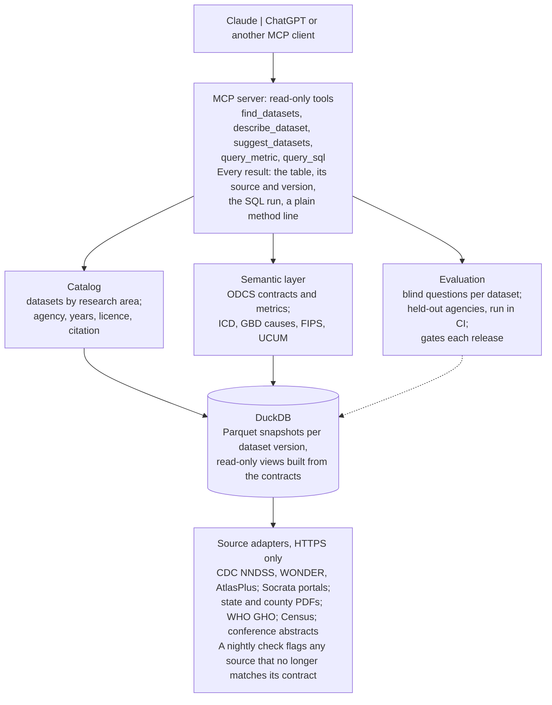
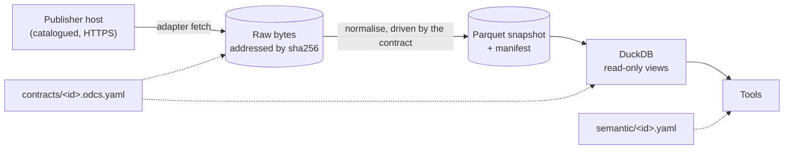

# Architecture

The client only ever sees the tools. Everything that decides what a number means lives in reviewed contracts and
metrics. Data comes from a snapshot built outside the chat, or, for sources whose terms forbid mirroring, from the
publisher at run time.

## The pieces

Evaluation is not called by the server at question time. It runs in CI and gates each release; it sits in this
layer because it checks the same catalog and semantic layer the tools use.

| Module | Role |
|---|---|
| `server.py` | The MCP server over stdio; registers the tools |
| `tools.py` | The tools: `find_datasets`, `describe_dataset`, `suggest_datasets`, `query_metric`, `query_sql` (Phase 2); `get_aligned_with_gbd` and `find_prior_work` later |
| `catalog.py` | Loads `catalog/<id>.yaml`; ranks datasets for `find_datasets` and `suggest_datasets` |
| `contracts.py` | Loads `contracts/<id>.odcs.yaml` (ODCS v3.2.0) |
| `semantic.py` | Loads `semantic/<id>.yaml`; compiles a metric request to SQL with its aggregation rule |
| `sql_guard.py` | Checks `query_sql` statements: read-only, bounded, declared joins only |
| `store.py` | Parquet snapshots, manifests and DuckDB read-only views |
| `fetch.py` | HTTPS-only fetches to catalogued publisher hosts; raw bytes kept by sha256 |
| `adapters/socrata.py`, `adapters/who_gho.py` | Per-portal fetch and column metadata |
| `cli.py` | `serve`, `refresh <dataset>\|--all`, `check-contracts`, `validate` |

## Data flow

1. **Adapter fetch.** `refresh <dataset>` (a scheduled job or a person) calls the dataset's adapter. `fetch.py`
   allows only the publisher hosts in the catalog, over HTTPS. Primary sources only
   ([ADR 0002](adr/0002-primary-sources-only.md)).
2. **Raw bytes, hash-addressed.** Each response is stored as-is under its sha256, with its source URL and
   `retrieved_at`, before any parsing ([ADR 0005](adr/0005-raw-fetches-hash-addressed.md)).
3. **Contract-driven normalise.** The contract says what each column means: types, units, codes, missing-value
   codes and total rows. Normalising applies only those facts. A layout that doesn't match the contract fails the
   refresh; nothing is guessed, and no model output is stored as data
   ([ADR 0006](adr/0006-no-llm-extraction.md), [ADR 0007](adr/0007-odcs-contracts-and-semantic-models.md)).
4. **Parquet snapshot and manifest.** Each run writes a new dataset version: Parquet files plus a manifest that
   lists the raw hashes, source URLs, `retrieved_at`, and the contract and semantic model versions. Snapshots live
   in the local store (`lake/`, ignored by git) and, for redistributable sources, may be published to a public
   Hugging Face dataset ([ADR 0009](adr/0009-licences-decide-mirroring.md)).
5. **DuckDB read-only views.** `store.py` builds views over the snapshot from the contract. Connections are
   read-only.
6. **Tools.** `query_metric` compiles a semantic-model metric to SQL over the views; `query_sql` runs a guarded
   read-only statement ([ADR 0008](adr/0008-governed-sql-and-metrics.md)). Every result returns the provenance from
   the manifest ([ADR 0003](adr/0003-provenance-on-every-result.md)).

Sources whose terms forbid mirroring, such as WHO GHO, run steps 1–5 at question time on the user's machine, and
their raw bytes and snapshots are never published. GBD never enters this flow; it is reached through the IHME
connector ([ADR 0004](adr/0004-aligned-data-no-gbd-verdicts.md)).

## What runs where

| Where | What |
|---|---|
| Scheduled job (weekly) | `refresh --all` for redistributable sources; contract checks; a PR when a source changes shape |
| CI (every PR, nightly) | `make check`, contract and metamorphic tests; nightly freshness check against each contract |
| Release | The held-out blind evaluation, once; the release bar is at most 2% wrong among answered and at least 80% right among answerable |
| User's machine | `health-data-registry serve` over stdio; run-time fetches for restricted sources; no telemetry |
