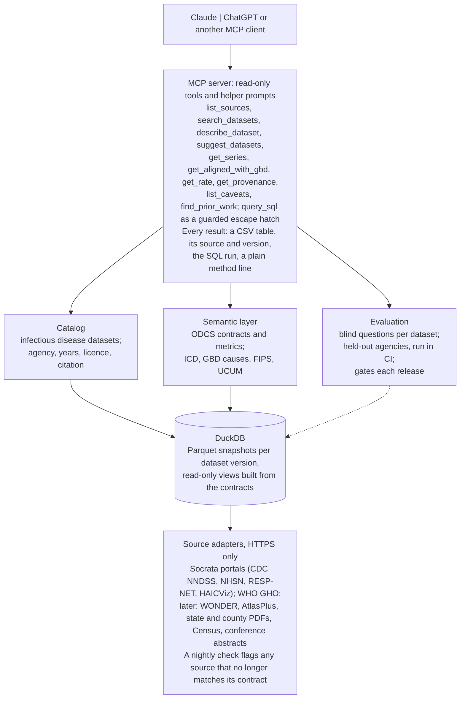
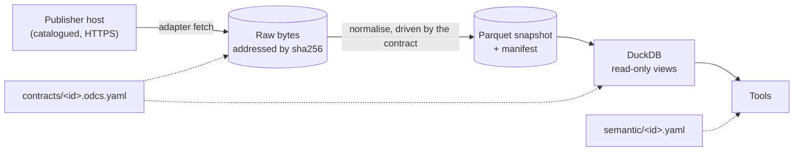

# Architecture

The client only ever sees the tools and the helper prompts. Everything that decides what a number means lives in
reviewed contracts and metrics. Data comes from snapshots built outside the chat. Sources whose terms forbid
mirroring are fetched from the publisher onto the user's own machine and never published.

## The pieces

Evaluation is not called by the server at question time. It runs in CI and gates each release; it sits in this
layer because it checks the same catalog and semantic layer the tools use.

| Module | Role |
|---|---|
| `server.py` | The MCP server over stdio; registers the tools and helper prompts; turns any failure into a plain-words refusal |
| `tools.py` | `list_sources`, `search_datasets`, `describe_dataset`, `suggest_datasets`, `get_series`, `get_aligned_with_gbd`, `get_rate`, `get_provenance`, `list_caveats`, `find_prior_work` ("index not built yet"), `query_sql`; CSV by default |
| `helpers.py` | The clinician helpers, one per step from setup to pitch, served as MCP prompts; [helpers.md](helpers.md) is generated from it |
| `registry.py` | Loads and cross-checks `catalog/<id>.yaml`, `contracts/<id>.odcs.yaml` (ODCS v3.2.0) and `semantic/<id>.yaml` |
| `query.py` | The read path: attaches snapshots read-only, compiles semantic-model metrics to SQL, runs guarded SQL, wraps every answer with its provenance |
| `sql_guard.py` | Checks `query_sql` statements: one read-only SELECT, allowlisted functions, declared joins only |
| `store.py` | The lake: raw bytes by sha256, snapshots partitioned by source and run date with manifests, the `LATEST` pointer, the fetch log |
| `crawl.py` | Fetch one source into a lake: every attempt logged, raw bytes kept, one snapshot |
| `publish.py` | `export-public`: hub release with cards, licence texts, Parquet and `manifest.json`; listed-not-hosted cards; pre-publish checks; upload and `release-<run date>` tag |
| `hub.py` | The hosted read path: immutable hub release, sha256 check, fail-closed contract check, bounded cache |
| `live.py` | Restricted-licence sources (WHO GHO): read live from the publisher per question, in memory only, never written to disk |
| `product.py` | Reads the ODPS data product (`contracts/health-data-registry.odps.yaml`) and its output ports |
| `fetch.py` | HTTPS-only fetches to catalogued, publicly routable publisher hosts |
| `geo.py` | One place whatever the publisher calls it; GBD location names |
| `evaluation.py` | Sealed blind sets, the scorer and the release gate |
| `adapters/socrata.py`, `adapters/who_gho.py` | Per-portal fetch and column metadata |
| `cli.py` | `serve`, `refresh <dataset>\|--all`, `fetch <source>`, `export-public --to`, `check-contracts`, `validate`, `eval` |

## Data flow

1. **Adapter fetch.** `refresh <dataset>` (a scheduled job or a person) calls the dataset's adapter. `fetch.py`
   allows only the publisher hosts in the catalog, over HTTPS. Primary sources only
   ([ADR 0002](adr/0002-primary-sources-only.md)).
2. **Raw bytes, hash-addressed.** Each response is stored as-is under its sha256, with its source URL and
   `retrieved_at`, before any parsing ([ADR 0005](adr/0005-raw-fetches-hash-addressed.md)).
3. **Contract-driven normalise.** The contract says what each column means: types, units, codes, missing-value
   codes and total rows. Normalising applies only those facts. A layout that doesn't match the contract fails the
   refresh; nothing is guessed, and no model output is stored as data
   ([ADR 0006](adr/0006-no-llm-extraction.md), [ADR 0007](adr/0007-odcs-contracts-and-semantic-models.md)).
4. **Parquet snapshot and manifest.** Each run writes a new dataset version under
   `datasets/<id>/<snapshot_id>/`: `data.parquet`, `data.duckdb` and a `manifest.json` that lists the raw hashes, source URLs, `retrieved_at`, and the contract and semantic model versions. Snapshots live
   in the lake (`$HDR_LAKE`, default `./lake`, ignored by git) and, for redistributable sources, may be published to a public
   Hugging Face dataset ([ADR 0009](adr/0009-licences-decide-mirroring.md)).
5. **DuckDB read-only views.** `store.py` builds views over the snapshot from the contract. Connections are
   read-only.
6. **Tools.** `get_series`, `get_aligned_with_gbd` and the other tools compile semantic-model metrics to SQL over
   the views, so the aggregation rules apply; `query_sql` runs a guarded read-only statement ([ADR 0008](adr/0008-governed-sql-and-metrics.md)). Every result returns the provenance from
   the manifest ([ADR 0003](adr/0003-provenance-on-every-result.md)).

Sources whose terms forbid mirroring, such as WHO GHO, are fetched from the publisher onto the user's own machine
(today by `refresh`, which the setup guide runs once), and their raw bytes and snapshots are never published. GBD never enters this flow; it is reached through the IHME
connector ([ADR 0004](adr/0004-aligned-data-no-gbd-verdicts.md)).

## What runs where

| Where | What |
|---|---|
| Scheduled job (weekly) | `refresh --all` for redistributable sources; contract checks; a PR when a source changes shape |
| CI (every PR, nightly) | `make check`, contract and metamorphic tests; nightly freshness check against each contract |
| Release | The held-out blind evaluation, once; the release bar is at most 2% wrong among answered and at least 80% right among answerable |
| User's machine | `health-data-registry serve` over stdio; `refresh` into the user's own lake; no telemetry |
